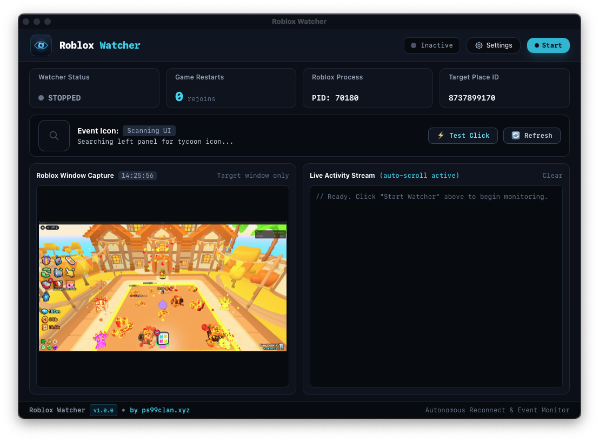

# Roblox Watcher (macOS)

A high-performance native macOS utility designed to monitor Roblox, detect disconnections via on-device Apple Vision OCR, automatically reconnect, and navigate back to event areas (e.g. Pet Simulator 99 events).

Available as both a **Native macOS App with Menu Bar controls** and a lightweight **Headless CLI**.

<p align="center">
  
</p>

---

## Features

- **Apple Vision OCR**: 100% local, on-device text recognition. Scans only the Roblox window in under 500ms without cloud APIs or external dependencies.
- **Auto-Reconnect & Fallback**: Detects error dialogs (`"Disconnected"`, Error 277, etc.), locates the on-screen "Reconnect" button, and clicks it automatically. If kicked, relaunches via Place ID or VIP link.
- **Event Auto-Navigation**: Waits for game reload, identifies event icons on the left UI panel (e.g. Pumpkin Tycoon), and dispatches teleport clicks.
- **macOS Menu Bar Integration**: Lives in the top menu bar with live status indicators:
  - **White**: Inactive / idle.
  - **Cyan Blue**: Actively monitoring and watching.
  - Background execution: Closing the main window keeps the watcher alive in the menu bar.
- **Interactive Native Dashboard**: Embedded dark-themed UI showing live Roblox process PID, live screenshot thumbnail, OCR scan telemetry, event crop preview, and restart counters.

---

## Operating Modes

### 1. Native GUI App (`Roblox Watcher.app`)
The primary desktop experience:
- Launch from `/Applications` or double-click `Roblox Watcher.app`.
- Start/stop monitoring using the in-app controls or the menu bar menu.
- Configure check intervals, target Place ID, VIP server links, and OCR keywords directly in the UI.

### 2. Headless CLI (`roblox-watcher`)
Designed for background automation, remote rigs, or terminal workflows:
- Run directly in your shell:
  ```bash
  ./roblox-watcher
  ```
- Reads settings from `config.json` (auto-generated on first run) and logs scan metrics and actions to `stdout`.

---

## How It Works

1. **Process Tracking**: Polls `NSWorkspace` for active `RobloxPlayer` processes and extracts active Place IDs.
2. **Window Capture**: Uses `CGWindowListCopyWindowInfo` and CoreGraphics to capture only the active Roblox window.
3. **On-Device OCR**: Runs `VNRecognizeTextRequest` with `.accurate` recognition.
4. **Action Dispatch**:
   - Matches disconnect phrases (`"Disconnected"`, `"Server was shut down"`, `"Error Code"`).
   - Simulates window activation and mouse clicks using `CGEventCreateMouseEvent`.
   - Re-teleports to event hubs using configured keywords (`"pumpkin"`, `"tycoon"`).

---

## Building Locally

### Prerequisites
- macOS 14.0 (Sonoma) or newer.
- Apple Silicon (M1/M2/M3/M4) or Intel Mac.
- Xcode Command Line Tools:
  ```bash
  xcode-select --install
  ```

### Build Command
Run the unified build script:
```bash
./build.sh
```

### Build Artifacts
`./build.sh` produces three targets:
- `roblox-watcher-v<version>`: Standalone Universal CLI binary (symlinked as `roblox-watcher`).
- `Roblox Watcher.app`: Native macOS application bundle.
- `Roblox-Watcher-v<version>.dmg`: Distributable disk image with `/Applications` drag-and-drop installer.

---

## Testing

Run the automated unit test suite:
```bash
./test.sh
```
Executes 52 assertions across 8 test suites validating OCR classification, Voice Chat notification filtering, Anti-AFK countdown calculations, placeId regex parsing, config serialization, and POSIX kernel file locks in <5ms. Automatically runs during `./build.sh` and CI.

---

## Release Process & Version Bumping

The single source of truth for the project version is the root `VERSION` file.

To bump the version and publish a release:
1. Run the bump script (`patch`, `minor`, or `major`):
   ```bash
   ./bump.sh patch
   ```
2. Commit and tag:
   ```bash
   git commit -am "chore: release v$(cat VERSION)"
   git tag "v$(cat VERSION)"
   git push origin main --tags
   ```
3. GitHub Actions (`.github/workflows/build.yml`) automatically builds the `.dmg` on `macos-latest`, generates release notes, and attaches the downloadable installer to the GitHub Release.

---

## Configuration (`config.json`)

The app automatically generates `config.json` on first run if not present:

```json
{
  "checkIntervalSeconds": 5.0,
  "reconnectCooldownSeconds": 30.0,
  "placeId": "8737899170",
  "vipServerUrl": "",
  "autoClickReconnect": true,
  "autoRelaunchOnKick": true,
  "autoTeleportToEvent": true,
  "reconnectButtonText": "Reconnect",
  "disconnectKeywords": [
    "disconnected",
    "please reconnect",
    "connection lost",
    "server was shut down",
    "error code: 277"
  ],
  "eventTargetKeywords": [
    "pumpkin",
    "tycoon"
  ]
}
```

---

## Installation & Gatekeeper (First Launch)

1. Download `Roblox-Watcher-v<version>.dmg` from the [Latest Release](https://github.com/pawel-antczak/roblox-watcher/releases/latest).
2. Open the `.dmg` and drag **Roblox Watcher.app** into `/Applications`.
3. If macOS blocks launch because the open-source developer cannot be verified, clear the browser quarantine attribute via Terminal:
   ```bash
   xattr -cr "/Applications/Roblox Watcher.app"
   ```
   *(Alternatively, go to **System Settings > Privacy & Security**, scroll down to the Security section, and click **Open Anyway**)*.

---

## Permissions

Roblox Watcher requires macOS accessibility and recording permissions to inspect the window and dispatch clicks:
1. **Screen Recording**: `System Settings > Privacy & Security > Screen & System Audio Recording` -> Enable **Roblox Watcher**.
2. **Accessibility**: `System Settings > Privacy & Security > Accessibility` -> Enable **Roblox Watcher**.

---

## License

MIT License. See [LICENSE](LICENSE) for details.
